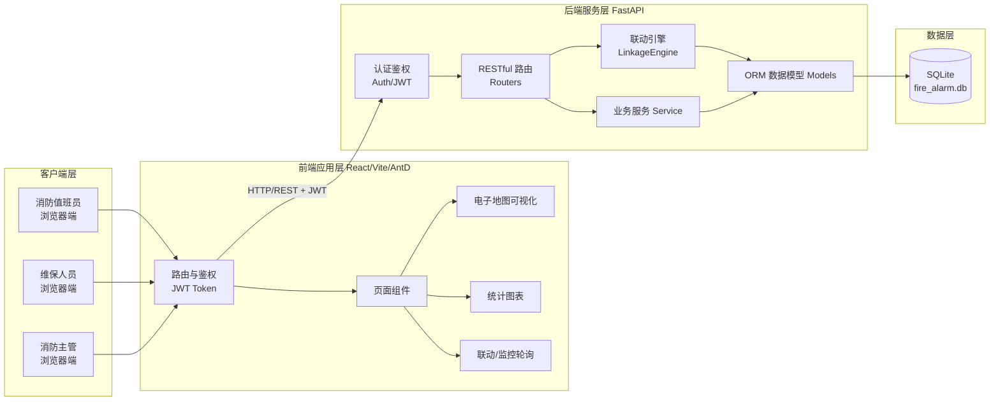
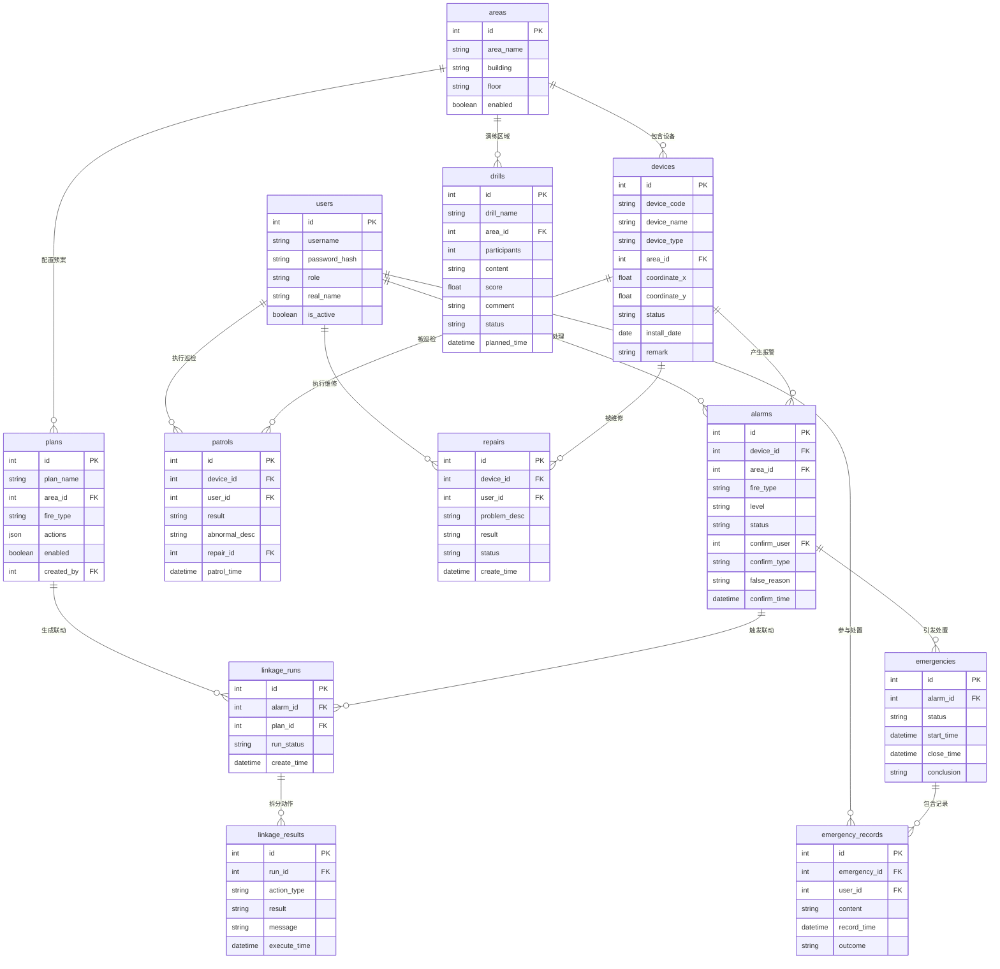
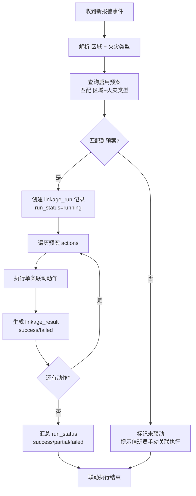
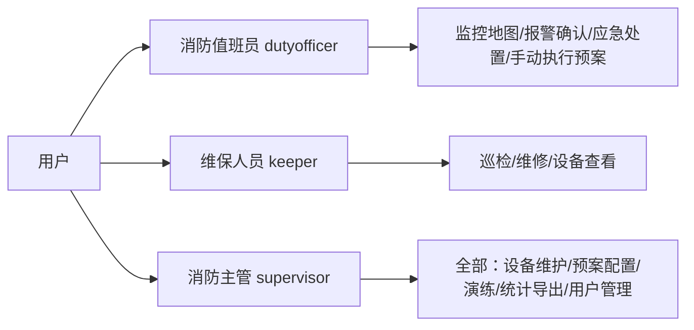
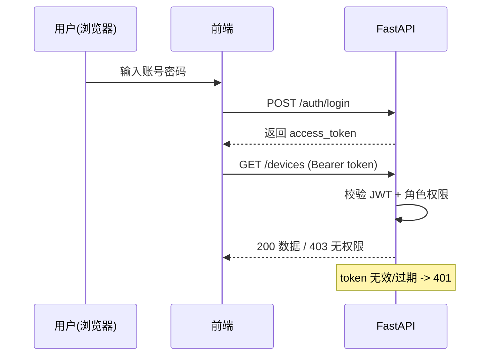

# 消防报警联动控制系统——技术方案文档

> 文档版本：V1.0
> 编写日期：2026-09-25
> 文档性质：系统设计与技术实施方案
> 适用范围：某大型商业综合体消防报警联动控制系统（一期）

---

## 1. 系统总体架构

### 1.1 架构总览

系统采用**前后端分离**架构：前端 React（Vite + Ant Design），后端 Python FastAPI，数据库 SQLite，通过 RESTful API 通信，使用 JWT 进行鉴权。联动引擎常驻后端，负责报警触发后的预案匹配与联动动作执行。



### 1.2 架构分层说明

| 层次 | 技术 | 职责 |
| --- | --- | --- |
| 客户端层 | 浏览器（Chrome/Edge） | 用户访问入口，无需安装客户端 |
| 前端应用层 | React 18 + Vite + Ant Design 5 + ECharts | 页面渲染、电子地图可视化、统计图表、轮询刷新、路由与权限菜单 |
| API 层 | RESTful API + JWT | 前后端数据交互、鉴权校验、统一响应与错误码 |
| 后端业务层 | FastAPI + SQLAlchemy ORM | 业务逻辑、联动引擎、预案匹配、权限控制 |
| 数据层 | SQLite | 本地持久化存储，含用户/区域/设备/预案/报警/联动/处置/巡检/维修/演练数据 |

### 1.3 前端架构

- **构建**：Vite 提供快速构建与热更新；
- **UI**：Ant Design 5 提供组件库，规范界面；
- **状态管理**：React 状态 + Context / 轻量状态库；
- **路由与权限**：前端路由按角色过滤菜单，未授权菜单不展示；所有业务请求携带 JWT；
- **可视化**：电子地图用坐标渲染（自绘 / 轻量地图库），统计用 ECharts 图表；
- **实时刷新**：监控大屏采用定时轮询（建议 5 秒）拉取设备状态与最新报警。

### 1.4 后端架构

- **框架**：FastAPI，异步支持，自动生成 OpenAPI 文档（`/docs`）；
- **数据访问**：SQLAlchemy ORM 映射到 SQLite；
- **联动引擎**：独立服务模块，监听新报警事件，匹配预案并逐条执行联动动作、记录结果；
- **鉴权**：JWT 中间件（`HTTPBearer` / OAuth2PasswordBearer），解析令牌并注入当前用户；
- **权限**：装饰器/依赖实现 RBAC 三角色校验；
- **配置**：集中配置（数据库路径、JWT 密钥、令牌有效期、轮询周期等）。

---

## 2. 技术选型及理由

| 类别 | 选型 | 版本示例 | 选型理由 |
| --- | --- | --- | --- |
| 前端框架 | React | 18.x | 组件化成熟、生态丰富、社区活跃 |
| 构建工具 | Vite | 5.x | 启动/热更新快，适合中后台快速迭代 |
| UI 组件库 | Ant Design | 5.x | 企业级中后台组件完善，表格/表单/权限菜单开箱即用 |
| 图表库 | ECharts | 5.x | 统计看板图表丰富，性能好 |
| 后端框架 | FastAPI | 0.1xx | 高性能、异步、类型校验、自动接口文档 |
| ORM | SQLAlchemy | 2.x | 主流 Python ORM，兼容 SQLite，迁移方便 |
| 数据库 | SQLite | 3.x | 轻量、零部署、单文件便于交付，满足单节点消防管理规模 |
| 鉴权 | JWT + PyJWT | 2.x | 无状态令牌，适用于前后端分离 |
| 密码安全 | passlib/bcrypt | 1.x | 密码哈希存储 |
| 文档 | OpenAPI / Swagger | — | FastAPI 自动生成，便于联调与测试 |
| 前后端联调 | Axios | 1.x | 统一 HTTP 客户端，拦截器处理 401/403 |

> 数据库选型说明：本项目面向单商业综合体、单节点部署，设备/报警数据规模在 SQLite 可支撑范围（万级设备、十万级报警），选 SQLite 可显著降低部署运维成本。若后续扩展多楼宇/多中心/高并发，可平滑迁移至 PostgreSQL/MySQL（ORM 层不变）。

---

## 3. 数据库设计说明

### 3.1 ER 关系总览



### 3.2 数据表结构

#### 3.2.1 users（用户表）

| 字段 | 类型 | 约束 | 说明 |
| --- | --- | --- | --- |
| id | INTEGER | PK, 自增 | 用户 ID |
| username | TEXT/VARCHAR | UNIQUE, NOT NULL | 用户名 |
| password_hash | TEXT | NOT NULL | 密码哈希 |
| role | TEXT | NOT NULL | 角色：dutyofficer/keeper/supervisor |
| real_name | TEXT | 可空 | 姓名 |
| is_active | BOOLEAN | 默认 true | 是否启用 |
| created_at | DATETIME | 默认当前 | 创建时间 |

#### 3.2.2 areas（区域表）

| 字段 | 类型 | 约束 | 说明 |
| --- | --- | --- | --- |
| id | INTEGER | PK | 区域 ID |
| area_name | TEXT | NOT NULL | 区域名称 |
| building | TEXT | 可空 | 所在建筑 |
| floor | TEXT | 可空 | 楼层 |
| enabled | BOOLEAN | 默认 true | 是否启用 |

#### 3.2.3 devices（设备表）

| 字段 | 类型 | 约束 | 说明 |
| --- | --- | --- | --- |
| id | INTEGER | PK | 设备 ID |
| device_code | TEXT | UNIQUE, NOT NULL | 设备编号 |
| device_name | TEXT | NOT NULL | 设备名称 |
| device_type | TEXT | NOT NULL | 设备类型枚举 |
| area_id | INTEGER | FK→areas.id | 所属区域 |
| coordinate_x | REAL | NOT NULL | 地图 X 坐标 |
| coordinate_y | REAL | NOT NULL | 地图 Y 坐标 |
| status | TEXT | NOT NULL | 状态：normal/alarm/fault/blocked |
| install_date | DATE | 可空 | 安装日期 |
| remark | TEXT | 可空 | 备注 |

#### 3.2.4 plans（联动预案表）

| 字段 | 类型 | 约束 | 说明 |
| --- | --- | --- | --- |
| id | INTEGER | PK | 预案 ID |
| plan_name | TEXT | NOT NULL | 预案名称 |
| area_id | INTEGER | FK→areas.id | 关联区域 |
| fire_type | TEXT | NOT NULL | 火灾类型枚举 |
| actions | JSON | NOT NULL | 联动动作列表 |
| enabled | BOOLEAN | 默认 true | 是否启用 |
| created_by | INTEGER | FK→users.id | 创建人 |

#### 3.2.5 alarms（报警表）

| 字段 | 类型 | 约束 | 说明 |
| --- | --- | --- | --- |
| id | INTEGER | PK | 报警 ID |
| device_id | INTEGER | FK→devices.id | 触发设备 |
| area_id | INTEGER | FK→areas.id | 报警区域 |
| fire_type | TEXT | 可空 | 火灾类型 |
| level | TEXT | 默认 warning | 预警级别 |
| status | TEXT | NOT NULL | 状态：pending/processing/confirmed_false/confirmed_true |
| confirm_user | INTEGER | FK→users.id, 可空 | 确认人 |
| confirm_type | TEXT | 可空 | 确认类型：real/false |
| false_reason | TEXT | 可空 | 误报原因 |
| confirm_time | DATETIME | 可空 | 确认时间 |
| created_at | DATETIME | 默认当前 | 报警时间 |

#### 3.2.6 linkage_runs（联动执行记录表）

| 字段 | 类型 | 约束 | 说明 |
| --- | --- | --- | --- |
| id | INTEGER | PK | 联动执行 ID |
| alarm_id | INTEGER | FK→alarms.id | 关联报警 |
| plan_id | INTEGER | FK→plans.id | 关联预案 |
| run_status | TEXT | NOT NULL | running/success/partial/failed |
| create_time | DATETIME | 默认当前 | 创建时间 |

#### 3.2.7 linkage_results（联动结果明细表）

| 字段 | 类型 | 约束 | 说明 |
| --- | --- | --- | --- |
| id | INTEGER | PK | 结果 ID |
| run_id | INTEGER | FK→linkage_runs.id | 关联联动执行 |
| action_type | TEXT | NOT NULL | 动作类型枚举 |
| result | TEXT | NOT NULL | success/failed |
| message | TEXT | 可空 | 执行反馈 |
| execute_time | DATETIME | 默认当前 | 执行时间 |

#### 3.2.8 emergencies（应急处置表）

| 字段 | 类型 | 约束 | 说明 |
| --- | --- | --- | --- |
| id | INTEGER | PK | 处置单 ID |
| alarm_id | INTEGER | FK→alarms.id | 关联报警 |
| status | TEXT | NOT NULL | ongoing/closed |
| start_time | DATETIME | NOT NULL | 启动时间 |
| close_time | DATETIME | 可空 | 闭环时间 |
| conclusion | TEXT | 可空 | 处置结论 |

#### 3.2.9 emergency_records（应急处置记录表）

| 字段 | 类型 | 约束 | 说明 |
| --- | --- | --- | --- |
| id | INTEGER | PK | 记录 ID |
| emergency_id | INTEGER | FK→emergencies.id | 关联处置单 |
| user_id | INTEGER | FK→users.id | 操作/参与人员 |
| content | TEXT | NOT NULL | 处置内容 |
| record_time | DATETIME | 默认当前 | 记录时间 |
| outcome | TEXT | 可空 | 结果/进展 |

#### 3.2.10 patrols（巡检记录表）

| 字段 | 类型 | 约束 | 说明 |
| --- | --- | --- | --- |
| id | INTEGER | PK | 巡检 ID |
| device_id | INTEGER | FK→devices.id | 巡检设备 |
| user_id | INTEGER | FK→users.id | 巡检人 |
| result | TEXT | NOT NULL | normal/abnormal |
| abnormal_desc | TEXT | 可空 | 异常说明 |
| repair_id | INTEGER | FK→repairs.id, 可空 | 关联维修单 |
| patrol_time | DATETIME | 默认当前 | 巡检时间 |

#### 3.2.11 repairs（维修记录表）

| 字段 | 类型 | 约束 | 说明 |
| --- | --- | --- | --- |
| id | INTEGER | PK | 维修单 ID |
| device_id | INTEGER | FK→devices.id | 维修设备 |
| user_id | INTEGER | FK→users.id | 维修人 |
| problem_desc | TEXT | NOT NULL | 问题描述 |
| result | TEXT | 可空 | 维修结果 |
| status | TEXT | NOT NULL | pending/processing/done |
| create_time | DATETIME | 默认当前 | 创建时间 |

#### 3.2.12 drills（演练记录表）

| 字段 | 类型 | 约束 | 说明 |
| --- | --- | --- | --- |
| id | INTEGER | PK | 演练 ID |
| drill_name | TEXT | NOT NULL | 演练主题 |
| area_id | INTEGER | FK→areas.id | 演练区域 |
| participants | INTEGER | 可空 | 参演人数 |
| content | TEXT | 可空 | 演练内容 |
| score | REAL | 可空 | 评分 |
| comment | TEXT | 可空 | 评估意见 |
| status | TEXT | NOT NULL | planned/ongoing/archived |
| planned_time | DATETIME | 可空 | 计划时间 |

### 3.3 核心枚举定义

**设备类型枚举**：

| 枚举值 | 中文 | 说明 |
| --- | --- | --- |
| SMOKE | 烟感 | 烟雾探测器 |
| HEAT | 温感 | 温度探测器 |
| MANUAL | 手报 | 手动报警按钮 |
| HYDRANT | 消火栓 | 室内消火栓 |
| SPRINKLER | 喷淋 | 自动喷淋 |
| EXHAUST | 排烟 | 排烟系统 |
| FIRE_DOOR | 防火门 | 防火分隔门 |
| EMERGENCY_LIGHT | 应急照明 | 疏散应急照明 |

**设备状态枚举**：

| 枚举值 | 中文 | 显示色 | 说明 |
| --- | --- | --- | --- |
| normal | 正常 | 绿 | 设备工作正常 |
| alarm | 报警 | 红 | 设备触发报警 |
| fault | 故障 | 橙 | 设备异常/维修中 |
| blocked | 屏蔽 | 灰 | 设备被人工屏蔽 |

**联动动作枚举**：

| 枚举值 | 中文 | 说明 |
| --- | --- | --- |
| START_EXHAUST | 启动排烟 | 开启排烟机 |
| CLOSE_FIRE_DOOR | 关闭防火门 | 关闭防火分隔 |
| START_EMERGENCY_LIGHT | 启动应急照明 | 应急照明开启 |
| ACTIVATE_BROADCAST | 疏散广播 | 触发疏散语音广播 |

**火灾类型枚举**：`COMMON`（普通火灾）、`ELECTRICAL`（电气火灾）、`OIL_SMOKE`（油烟火灾）、`OTHER`（其他）。

**角色枚举**：`dutyofficer`（消防值班员）、`keeper`（维保人员）、`supervisor`（消防主管）。

**联动执行状态枚举**：`running`（执行中）、`success`（全部成功）、`partial`（部分成功）、`failed`（执行失败）。

---

## 4. 接口设计

> 统一接口前缀：`/api/v1`；鉴权方式：`Authorization: Bearer <JWT>`；统一响应格式见下文。

### 4.1 统一响应格式

```json
{
  "code": 0,
  "message": "success",
  "data": { }
}
```
- 成功：`code = 0`，业务数据在 `data`；
- 失败：`code` 为业务错误码，`message` 为错误描述（详见第 7 章错误码）。

### 4.2 认证与鉴权接口

| REST 方法 | 路径 | 说明 |
| --- | --- | --- |
| POST | /api/v1/auth/login | 登录，返回 JWT |
| POST | /api/v1/auth/logout | 退出登录 |
| GET | /api/v1/auth/me | 获取当前用户信息与角色 |

**登录请求：**

```http
POST /api/v1/auth/login
Content-Type: application/json

{
  "username": "duty01",
  "password": "******"
}
```

**登录响应：**

```json
{
  "code": 0,
  "message": "success",
  "data": {
    "access_token": "eyJhbGciOiJIUzI1NiIs...",
    "token_type": "bearer",
    "user": { "id": 1, "username": "duty01", "role": "dutyofficer", "real_name": "张值班" }
  }
}
```

### 4.3 设备接口

| REST 方法 | 路径 | 说明 |
| --- | --- | --- |
| GET | /api/v1/devices | 分页/筛选查询设备列表 |
| POST | /api/v1/devices | 新增设备 |
| GET | /api/v1/devices/{id} | 设备详情 |
| PUT | /api/v1/devices/{id} | 编辑设备 |
| DELETE | /api/v1/devices/{id} | 删除/屏蔽设备 |
| PUT | /api/v1/devices/{id}/status | 更新设备状态 |

**新增设备请求：**

```http
POST /api/v1/devices
{
  "device_code": "SMK-A-001",
  "device_name": "A区1号烟感",
  "device_type": "SMOKE",
  "area_id": 1,
  "coordinate_x": 12.5,
  "coordinate_y": 30.2,
  "status": "normal",
  "install_date": "2026-06-01"
}
```

**新增设备响应：**

```json
{
  "code": 0,
  "message": "success",
  "data": { "id": 101, "device_code": "SMK-A-001", "device_name": "A区1号烟感", "status": "normal" }
}
```

### 4.4 区域接口

| REST 方法 | 路径 | 说明 |
| --- | --- | --- |
| GET | /api/v1/areas | 查询区域列表 |
| POST | /api/v1/areas | 新增区域 |
| PUT | /api/v1/areas/{id} | 编辑区域 |
| DELETE | /api/v1/areas/{id} | 删除区域 |

### 4.5 报警接口

| REST 方法 | 路径 | 说明 |
| --- | --- | --- |
| POST | /api/v1/alarms/simulate | 模拟触发报警（测试联调用） |
| GET | /api/v1/alarms | 报警列表/筛选 |
| GET | /api/v1/alarms/{id} | 报警详情 |
| POST | /api/v1/alarms/{id}/confirm | 火警确认（真实/误报） |
| GET | /api/v1/alarms/latest | 最新报警（监控大屏轮询） |

**模拟报警请求：**

```http
POST /api/v1/alarms/simulate
{
  "device_id": 101,
  "fire_type": "OIL_SMOKE"
}
```

**火警确认请求：**

```http
POST /api/v1/alarms/5/confirm
{
  "confirm_type": "false",
  "false_reason": "装修粉尘引起误触"
}
```

### 4.6 预案接口

| REST 方法 | 路径 | 说明 |
| --- | --- | --- |
| GET | /api/v1/plans | 预案列表 |
| POST | /api/v1/plans | 新增预案 |
| PUT | /api/v1/plans/{id} | 编辑预案 |
| PUT | /api/v1/plans/{id}/enabled | 启用/停用预案 |
| DELETE | /api/v1/plans/{id} | 删除预案 |
| POST | /api/v1/plans/{id}/execute | 手动执行预案 |

**手动执行预案请求/响应：**

```http
POST /api/v1/plans/3/execute
```

```json
{
  "code": 0,
  "message": "success",
  "data": { "run_id": 20, "run_status": "partial", "results": [ { "action_type": "START_EXHAUST", "result": "success" }, { "action_type": "ACTIVATE_BROADCAST", "result": "failed", "message": "广播设备离线" } ] }
}
```

### 4.7 联动接口

| REST 方法 | 路径 | 说明 |
| --- | --- | --- |
| GET | /api/v1/linkage/runs | 联动执行记录列表 |
| GET | /api/v1/linkage/runs/{id} | 联动执行详情（含明细结果） |

**联动执行详情响应（节选）：**

```json
{
  "code": 0,
  "message": "success",
  "data": {
    "run_id": 20,
    "alarm_id": 5,
    "plan_id": 3,
    "run_status": "partial",
    "results": [
      { "action_type": "START_EXHAUST", "result": "success", "execute_time": "2026-09-25T02:10:12" },
      { "action_type": "CLOSE_FIRE_DOOR", "result": "success", "execute_time": "2026-09-25T02:10:13" }
    ]
  }
}
```

### 4.8 应急处置接口

| REST 方法 | 路径 | 说明 |
| --- | --- | --- |
| GET | /api/v1/emergencies | 处置单列表 |
| POST | /api/v1/emergencies | 创建处置单（确认真实火警后） |
| GET | /api/v1/emergencies/{id} | 处置单详情 |
| POST | /api/v1/emergencies/{id}/records | 追加处置记录 |
| PUT | /api/v1/emergencies/{id}/close | 处置闭环 |

**创建处置单请求：**

```http
POST /api/v1/emergencies
{ "alarm_id": 5 }
```

**追加处置记录请求：**

```http
POST /api/v1/emergencies/1/records
{ "content": "已疏散C区人员，明火已扑灭", "outcome": "持续警戒" }
```

### 4.9 巡检接口

| REST 方法 | 路径 | 说明 |
| --- | --- | --- |
| GET | /api/v1/patrols | 巡检记录列表 |
| GET | /api/v1/patrols/tasks | 巡检任务（按周期生成） |
| POST | /api/v1/patrols | 提交巡检记录 |

**提交巡检记录请求：**

```http
POST /api/v1/patrols
{
  "device_id": 101,
  "result": "abnormal",
  "abnormal_desc": "压力表异常"
}
```

### 4.10 维修接口

| REST 方法 | 路径 | 说明 |
| --- | --- | --- |
| GET | /api/v1/repairs | 维修单列表 |
| POST | /api/v1/repairs | 创建维修单（巡检异常自动生成） |
| PUT | /api/v1/repairs/{id} | 维修处理/回填结果 |

**维修回填请求：**

```http
PUT /api/v1/repairs/12
{ "result": "已更换压力表，恢复正常", "status": "done" }
```

### 4.11 演练接口

| REST 方法 | 路径 | 说明 |
| --- | --- | --- |
| GET | /api/v1/drills | 演练记录列表 |
| POST | /api/v1/drills | 创建演练计划 |
| PUT | /api/v1/drills/{id} | 更新演练记录/评估归档 |

**创建演练计划请求：**

```http
POST /api/v1/drills
{ "drill_name": "2026Q4综合消防演练", "area_id": 3, "planned_time": "2026-11-20T09:00:00" }
```

### 4.12 统计与导出接口

| REST 方法 | 路径 | 说明 |
| --- | --- | --- |
| GET | /api/v1/stats/overview | 统计看板汇总指标 |
| GET | /api/v1/stats/alarm-trend | 报警趋势 |
| GET | /api/v1/stats/device-status | 设备状态分布 |
| GET | /api/v1/stats/export | 按类型导出 Excel/CSV |

**导出接口示例：** `GET /api/v1/stats/export?type=alarm&format=xlsx&start=2026-09-01&end=2026-09-25`，返回 `.xlsx` 或 `.csv` 文件流。

---

## 5. 联动引擎设计

### 5.1 职责

联动引擎（Linkage Engine）在后端常驻，负责：接收报警事件 → 匹配预案 → 生成联动执行记录 → 逐条执行动作 → 记录结果。

### 5.2 执行流程



### 5.3 设计要点

- **容错**：单条动作失败不影响其余动作执行，失败动作记录 `message`；
- **可追溯**：联动执行记录（run + 明细 result）与报警、预案双向关联；
- **自动 + 手动**：报警触发自动联动；值班员/主管亦可手动执行预案；
- **启用开关**：仅 `enabled=true` 的预案参与自动匹配；
- **幂等性**：同一报警重复触发时不重复生成联动（以报警为主键约束防止重复联动）。

---

## 6. 权限模型（RBAC）

### 6.1 模型



### 6.2 实现机制

- **前端**：根据角色渲染菜单与按钮，未授权项不展示；
- **后端**：FastAPI 依赖注入中读取当前用户角色，通过权限校验器拦截无权操作，返回 `403`；
- **数据范围**：三角色查看同一份实时数据，无区域级数据隔离（本系统按单园区建模）。

---

## 7. 错误码与鉴权机制

### 7.1 全局错误码

| 错误码 | HTTP 状态 | 含义 | 说明 |
| --- | --- | --- | --- |
| 0 | 200 | 成功 | 操作成功 |
| 1001 | 401 | 未认证 | 未携带或携带无效 token |
| 1002 | 403 | 无权限 | 越权访问（RBAC 校验失败） |
| 1003 | 400 | 参数错误 | 参数缺失/格式错误 |
| 1004 | 404 | 资源不存在 | 对象不存在 |
| 1005 | 409 | 冲突 | 数据唯一性冲突（如设备编号重复） |
| 1006 | 500 | 服务器内部错误 | 未预期异常 |
| 2001 | 400 | 登录失败 | 用户名或密码错误 |
| 3001 | 400 | 业务校验失败 | 如误报未填写原因 |
| 3002 | 400 | 状态约束 | 如存在记录不可物理删除 |

### 7.2 鉴权机制

- **签发**：登录成功签发 HS256 JWT，payload 含用户 ID、角色、过期时间；
- **校验**：后端中间件校验 `Authorization: Bearer <token>`，无效/过期 → 401；
- **权限**：业务接口依赖 `get_current_user` + `require_role(...)` 校验 → 无权限 403；
- **前端**：Axios 拦截器统一携带 token，收到 401 清除凭证并跳转登录，403 提示无权限。



---

## 8. 部署与启动

### 8.1 目录结构（部署视角）

```
fire-alarm/
├─ backend/
│  ├─ app/                 # FastAPI 应用
│  │  ├─ models/           # ORM 模型
│  │  ├─ schemas/          # Pydantic 校验
│  │  ├─ routers/          # 路由
│  │  ├─ services/         # 业务/联动引擎
│  │  ├─ core/             # 配置、鉴权、权限
│  │  └─ main.py           # 应用入口
│  └─ fire_alarm.db        # SQLite 数据库（运行生成）
├─ frontend/
│  └─ src/                 # React 源码
├─ docs/                   # 交付文档
└─ README.md
```

### 8.2 环境要求

| 项 | 要求 |
| --- | --- |
| Python | 3.10+ |
| Node.js | 18+ |
| 数据库 | SQLite（后端本地生成，无需额外安装） |
| 系统 | Windows / Linux 均可，单节点部署 |

### 8.3 启动步骤

1. **初始化后端环境**：创建虚拟环境并安装依赖（fastapi、uvicorn、sqlalchemy、pyjwt、passlib 等）；
2. **初始化数据库**：运行初始化脚本建表并写入种子数据（三角色账号、示例区域、示例设备）；
3. **启动后端**：`uvicorn app.main:app --host 0.0.0.0 --port 8000`，接口文档 `/docs`；
4. **启动前端**：`npm install` → `npm run dev`，浏览器访问前端地址；
5. **联调验证**：登录 → 模拟报警 → 查看自动联动与确认流程。

### 8.4 环境配置清单

| 配置项 | 默认 | 说明 |
| --- | --- | --- |
| DATABASE_URL | sqlite:///./fire_alarm.db | 数据库地址 |
| JWT_SECRET | 由部署环境注入 | 令牌签名密钥（生产须更换） |
| JWT_EXPIRE_MINUTES | 120 | 令牌有效期 |
| POLL_INTERVAL_SEC | 5 | 监控轮询周期 |
| CORS_ORIGINS | http://localhost:5173 | 前端跨域白名单 |

> 生产部署提醒：必须设置强随机 JWT_SECRET、开启 CORS 白名单、定期备份 `fire_alarm.db`。

---

> 本文档与《系统PRD文档.md》《测试用例.md》配套使用，作为开发、测试与部署的技术依据。