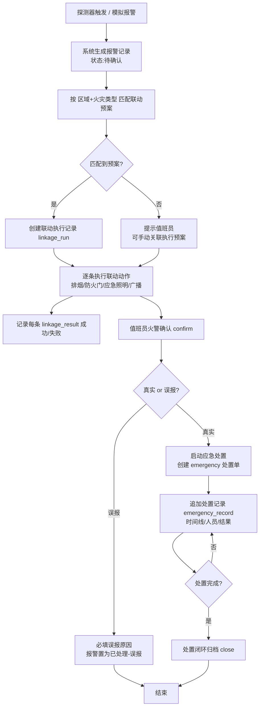
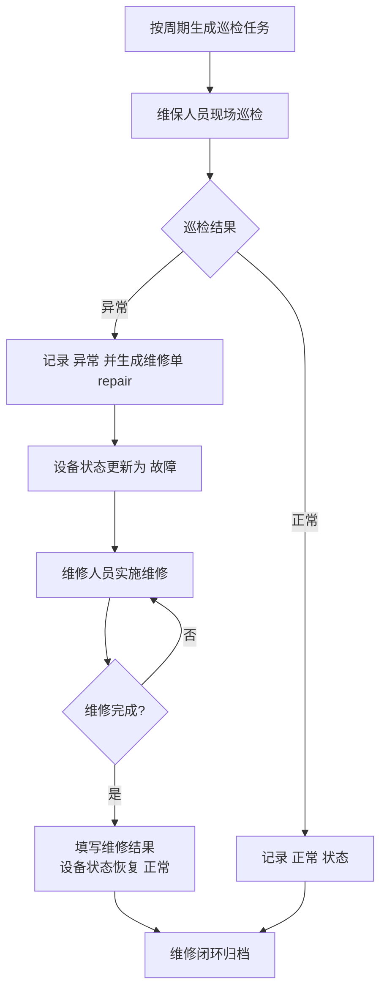
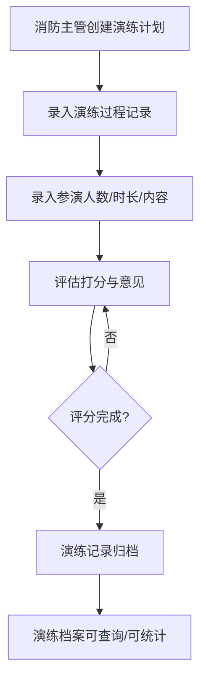

# 消防报警联动控制系统——系统PRD文档

> 文档版本：V1.0
> 编写日期：2026-09-25
> 文档性质：产品需求文档（Product Requirements Document）
> 适用范围：某大型商业综合体消防报警联动控制系统（一期）

---

## 1. 文档说明与术语

### 1.1 文档目的

本文档为"消防报警联动控制系统"的产品需求定义文档，面向产品、研发、测试、运维及消防管理等干系人，明确规定系统的**功能需求、业务规则、数据项、权限要求、核心业务流程、用户场景用例与非功能需求**，作为设计、开发、测试与验收的依据。

### 1.2 阅读对象

| 对象 | 关注章节 |
| --- | --- |
| 产品经理 / 需求分析师 | 全文 |
| 系统架构师 / 后端开发 | 第 4、5、7 章 |
| 前端开发 | 第 4 章 |
| 测试工程师 | 第 4、6、7 章 |
| 消防主管 / 消防安全负责人 | 第 2、3、6 章 |

### 1.3 术语表

| 术语 | 英文 / 缩写 | 定义 |
| --- | --- | --- |
| 消防报警联动控制系统 | Fire Alarm & Linkage Control System | 对火灾自动报警信号进行接收、研判、联动控制与处置管理的综合系统 |
| 火灾自动报警 | FAS | Fire Alarm System，探测器等前端设备自动探测并向系统上报火灾信号的机制 |
| 预警 | Early Warning | 系统在确认火警前，根据探测器信号按"区域 + 火灾类型"进行分级预警提示 |
| 联动 | Linkage | 火灾报警触发后，按预案自动/手动执行排烟、防火门、应急照明、疏散广播等动作 |
| 联动预案 | Linkage Plan | 按"区域 + 火灾类型"配置的联动动作组合与执行逻辑 |
| 火警确认 | Fire Confirmation | 值班员/应急处置人员现场核实报警真实性（真实火警 / 误报） |
| 误报 | False Alarm | 值班确认为非真实火警的报警，须记录原因 |
| 电子地图 | Electronic Map | 基于楼层/区域坐标的可视化地图，用于展示设备状态与位置 |
| 设备状态 | Device Status | 正常 / 报警 / 故障 / 屏蔽 四种状态 |
| RBAC | Role-Based Access Control | 基于角色的访问控制 |
| JWT | JSON Web Token | 用于登录鉴权的令牌机制 |
| 巡检 | Patrol | 按计划对消防设备进行的定期巡查 |
| 维修 | Repair | 对巡检/报警发现的故障设备进行维修并闭环处理 |
| 演练 | Drill | 有组织的消防应急演练计划、过程与评估管理 |
| 消防值班员 | Duty Officer | 承担实时监控、火警确认、应急处置执行的岗位 |
| 维保人员 | Maintenance Staff | 承担设备巡检、维修的岗位 |
| 消防主管 | Fire Supervisor | 承担预案、演练、统计及全局管理的岗位 |

---

## 2. 产品概述与背景

### 2.1 行业背景

火灾自动报警与消防联动是商业综合体、大型公共建筑消防安全管理的核心环节。商业综合体具有**人员密集、业态复杂、用电负荷高、疏散通道交错**等特点，火灾一旦发生若不能及时预警、联动处置，极易造成重大人员伤亡与财产损失。

传统消防管理普遍存在以下痛点：

1. **设备底数不清**：设备档案纸质化、台账分散，状态无法实时掌握；
2. **报警联动低效**：报警后依赖人工判断，联动动作靠人工逐项执行，响应慢、易遗漏；
3. **处置过程难追溯**：火警确认、应急处置过程缺乏留痕，误报原因不明，管理责任难以落实；
4. **巡检维保脱节**：巡检记录纸质化，异常问题不能及时流转为维修工单，形成闭环难；
5. **演练与统计缺失**：演练无计划、无评估；关键指标（误报率、联动成功率、巡检完成率）无法量化。

### 2.2 产品定位

本系统是一套**面向商业综合体的消防报警联动控制与消防管理一体化平台**，实现"火灾自动报警 — 自动联动 — 值班确认 — 应急处置 — 巡检维保 — 演练评估 — 统计决策"的全流程数字化闭环，为消防安全管理提供实时可视、自动联动、有据可查的支撑。

### 2.3 产品目标

| 目标 | 说明 |
| --- | --- |
| 实时可视 | 设备状态、报警、联动在电子地图与监控大屏实时呈现 |
| 自动联动 | 火警触发后按预案自动执行排烟、防火门、应急照明、疏散广播 |
| 快速确认 | 支持值班员快速确认真实火警/误报，误报必录原因 |
| 闭环管理 | 巡检→维修、报警→处置全程闭环可追溯 |
| 决策支撑 | 统计看板 + Excel/CSV 导出，支撑管理决策 |

---

## 3. 用户角色

系统采用 RBAC 三角色模型，各角色职责与数据范围如下。

### 3.1 消防值班员（Duty Officer）

| 项 | 内容 |
| --- | --- |
| 核心职责 | 7×24 小时实时监控、接收报警、火警确认、执行应急处置 |
| 可访问菜单 | 实时监控、电子地图、报警列表、火警确认、应急处置 |
| 业务操作 | 查看报警、确认火警（真实/误报）、发起应急处置、追加处置记录、手动执行预案 |
| 数据范围 | 全局实时数据（无区域隔离） |
| 不可访问 | 预案配置、巡检管理、演练管理、设备档案编辑、系统管理、统计导出（依据权限策略） |

### 3.2 维保人员（Maintenance Staff）

| 项 | 内容 |
| --- | --- |
| 核心职责 | 设备巡检、故障上报、维修实施 |
| 可访问菜单 | 设备巡检、维修管理、设备档案（查看） |
| 业务操作 | 巡检记录、异常转维修、维修完成回填 |
| 不可访问 | 预案配置、演练管理、统计导出、用户与权限管理 |

### 3.3 消防主管（Fire Supervisor）

| 项 | 内容 |
| --- | --- |
| 核心职责 | 全局管理、预案配置、演练组织、报表与决策 |
| 可访问菜单 | 全部菜单（设备、监控、报警、预案、应急处置、巡检、维修、演练、统计、系统管理） |
| 业务操作 | 设备档案增删改、预案配置、演练管理、统计导出、用户管理、报表导出 |

### 3.4 角色—权限矩阵

| 功能模块 | 消防值班员 | 维保人员 | 消防主管 |
| --- | --- | --- | --- |
| 登录鉴权 | √ | √ | √ |
| 设备档案（查看） | √ | √ | √ |
| 设备档案（增删改） | × | × | √ |
| 实时监控 / 电子地图 | √ | √ | √ |
| 报警列表 / 火警确认 | √ | × | √ |
| 联动预案配置 | × | × | √ |
| 预案手动执行 | √ | × | √ |
| 应急处置 | √ | × | √ |
| 设备巡检 | × | √ | √ |
| 维修管理 | × | √ | √ |
| 消防演练 | × | × | √ |
| 统计看板 / 导出 | × | × | √ |
| 用户与权限管理 | × | × | √ |

> 说明：× 代表角色在对应模块无权限，前端不展示菜单，后端接口进行权限校验（越权返回 403）。

---

## 4. 功能需求

> 每个功能包含：功能描述、业务规则、数据项、权限四部分。

---

### 4.1 消防设备档案管理

**功能描述**：维护商业综合体全部消防设备的基本档案，包括设备类型、所在区域、地图坐标、状态、安装信息，支撑电子地图展示与状态跟踪。支持新增、编辑、删除、查询、启停用（屏蔽）及状态变更。

**业务规则**：
- BR-F1-01：设备编号全局唯一，不可重复；
- BR-F1-02：删除设备须确认，且设备存在报警/处置记录时仅允许"屏蔽"不允许物理删除；
- BR-F1-03：设备状态仅可在【正常 / 报警 / 故障 / 屏蔽】之间流转，报警/故障状态由系统联动产生，屏蔽由管理员人工设置；
- BR-F1-04：地图坐标（x, y）必须在所在区域的边界范围内；
- BR-F1-05：设备类型编码参考枚举（见 4.1 数据项枚举）。

**数据项**：

| 字段 | 类型 | 必填 | 说明 |
| --- | --- | --- | --- |
| id | 整数 | 是 | 设备 ID |
| device_code | 字符串 | 是 | 设备编号（唯一） |
| device_name | 字符串 | 是 | 设备名称 |
| device_type | 枚举 | 是 | 烟感/温感/手报/消火栓/喷淋/排烟/防火门/应急照明等 |
| area_id | 整数 | 是 | 所属区域（外键） |
| coordinate_x / coordinate_y | 小数 | 是 | 地图坐标 |
| status | 枚举 | 是 | 正常/报警/故障/屏蔽（默认正常） |
| install_date | 日期 | 是 | 安装日期 |
| remark | 字符串 | 否 | 备注 |

**枚举（设备类型）**：`SMOKE(烟感)`、`HEAT(温感)`、`MANUAL(手报)`、`HYDRANT(消火栓)`、`SPRINKLER(喷淋)`、`EXHAUST(排烟)`、`FIRE_DOOR(防火门)`、`EMERGENCY_LIGHT(应急照明)`。

**权限**：查看——值班员/维保/主管；增删改与屏蔽——仅消防主管。

---

### 4.2 实时监控与电子地图

**功能描述**：提供监控大屏与楼层/区域电子地图，按坐标展示设备图标，用颜色区分状态（正常绿/报警红/故障橙/屏蔽灰），提供设备状态统计（正常/报警/故障/屏蔽数量）与最新报警列表，前端轮询实时刷新。

**业务规则**：
- BR-F2-01：设备图标颜色与状态一一映射：正常=绿、报警=红、故障=橙、屏蔽=灰；
- BR-F2-02：某设备触发报警后，地图图标即时变红，并进入最新报警列表头部（刷新周期建议 ≤ 5 秒）；
- BR-F2-03：支持按楼层/区域切换地图视图，且支持按设备类型筛选显示；
- BR-F2-04：点击设备图标可查看设备详情（类型/状态/坐标/最近报警）。

**数据项**：

| 字段 | 类型 | 说明 |
| --- | --- | --- |
| area | 区域对象 | 楼层/区域结构 |
| device | 设备对象 | 含坐标、类型、状态 |
| status_stats | 统计对象 | normal/alarm/fault/blocked 计数 |
| alarm_list | 报警列表 | 最新报警（含时间倒序） |

**权限**：值班员/维保/主管可见；维保人员只读同一份全量数据。

---

### 4.3 报警联动

**功能描述**：火灾报警触发后，系统按匹配的联动预案（区域 + 火灾类型）自动执行联动动作——启动排烟、关闭防火门、启动应急照明、疏散广播，并逐条记录联动指令执行状态（成功/失败）。

**业务规则**：
- BR-F3-01：报警触发后，系统依据报警所属区域与火灾类型匹配预案，未匹配到预案时提示值班员并允许手动关联执行；
- BR-F3-02：匹配成功后系统自动创建"联动执行记录（linkage_run）"，并逐条执行动作生成"联动结果（linkage_result）"；
- BR-F3-03：每条联动动作记录执行状态（成功/失败）与执行时间、动作类型；
- BR-F3-04：联动动作类型枚举：启动排烟、关闭防火门、启动应急照明、疏散广播；
- BR-F3-05：联动执行记录与对应报警/预案关联，可追溯。

**数据项**：

| 字段 | 类型 | 说明 |
| --- | --- | --- |
| alarm_id | 整数 | 关联报警 |
| plan_id | 整数 | 关联预案 |
| run_status | 枚举 | 执行中/成功/部分失败/失败 |
| linkage_action | 枚举 | 排烟/防火门/应急照明/广播 |
| action_result | 枚举 | 成功/失败 |
| execute_time | 时间 | 执行时间 |
| message | 字符串 | 执行反馈信息 |

**权限**：报警联动自动触发，无需人工授权；查看——值班员/主管。

---

### 4.4 联动预案配置

**功能描述**：支持按区域与火灾类型（电气火灾、普通火灾、油烟火灾等）配置联动预案，预案含动作列表（排烟机/防火门/应急照明/广播）；支持预案启停用与手动执行。

**业务规则**：
- BR-F4-01：预案唯一性 =「区域 + 火灾类型」组合唯一；
- BR-F4-02：预案动作列表至少包含一个联动动作；
- BR-F4-03：火灾类型枚举：`普通火灾`、`电气火灾`、`油烟火灾`、`其他`；
- BR-F4-04：启用的预案才参与自动联动匹配，停用预案仅支持手动执行；
- BR-F4-05：手动执行预案由值班员/主管触发，生成联动执行记录并逐条执行；
- BR-F4-06：预案配置变更须记录操作人。

**数据项**：

| 字段 | 类型 | 说明 |
| --- | --- | --- |
| id | 整数 | 预案 ID |
| plan_name | 字符串 | 预案名称 |
| area_id | 整数 | 区域 |
| fire_type | 枚举 | 火灾类型 |
| actions | JSON 数组 | 联动动作列表 |
| enabled | 布尔 | 是否启用 |
| created_by | 整数 | 创建人 |

**权限**：预案配置（增删改/启停用）——仅消防主管；手动执行——值班员/主管。

---

### 4.5 火警确认

**功能描述**：值班员对系统报警进行确认，判定为真实火警或误报；误报必须填写原因，确认记录与报警关联，更新报警状态。

**业务规则**：
- BR-F5-01：每条报警需由值班员进行确认并填写确认人、确认时间；
- BR-F5-02：判定为**误报**时，"误报原因"为必填项，不触发应急处置；
- BR-F5-03：判定为**真实火警**时，系统提示启动应急处置，报警状态更新为"已处理-真实"；
- BR-F5-04：确认完成后报警状态由"待确认"更新为"已处理"（真实火警）或"已处理（误报）"；
- BR-F5-05：误报原因入库，用于误报率统计。

**数据项**：

| 字段 | 类型 | 说明 |
| --- | --- | --- |
| alarm_id | 整数 | 关联报警 |
| confirm_type | 枚举 | 真实火警/误报 |
| false_reason | 字符串 | 误报原因（误报时必填） |
| confirm_user | 整数 | 确认人 |
| confirm_time | 时间 | 确认时间 |

**权限**：火警确认——值班员/消防主管。

---

### 4.6 应急处置

**功能描述**：确认真实火警后启动应急预案，创建处置单，记录处置过程时间线、参与人员与处置结果，完成后闭环归档。

**业务规则**：
- BR-F6-01：确认真实火警后生成应急处理单（emergency），此时联动已自动/手动执行；
- BR-F6-02：处置过程支持多条处置记录（emergency_record），含时间、操作、参与人员、结果；
- BR-F6-03：处置单状态流转：进行中 → 已闭环；未闭环前不可删除；
- BR-F6-04：处置闭环须记录处置结论与闭环时间；
- BR-F6-05：应急处置记录与火警确认记录关联。

**数据项**：

| 字段 | 类型 | 说明 |
| --- | --- | --- |
| emergency_id | 整数 | 处置单 ID |
| alarm_id | 整数 | 关联报警 |
| status | 枚举 | 进行中/已闭环 |
| start_time | 时间 | 启动时间 |
| close_time | 时间 | 闭环时间 |
| provenance | 字符串 | 处置结论 |
| records[ ] | 数组 | 处置记录（时间/内容/人员） |

**权限**：应急处置发起、追加记录、闭环——值班员/主管。

---

### 4.7 设备巡检

**功能描述**：支持按周期生成巡检任务，维保人员对设备进行巡检并记录结果（正常/异常），异常自动转维修，形成巡检台账。

**业务规则**：
- BR-F7-01：巡检任务按计划周期生成（日/周/月）；
- BR-F7-02：巡检结果枚举：正常/异常；
- BR-F7-03：巡检异常时自动生成维修单（repair），对应设备状态更新为"故障"；
- BR-F7-04：巡检记录包含巡检人、巡检时间、巡检结果、异常说明；
- BR-F7-05：未按期巡检的任务标注"逾期"。

**数据项**：

| 字段 | 类型 | 说明 |
| --- | --- | --- |
| patrol_id | 整数 | 巡检记录 ID |
| device_id | 整数 | 设备 |
| result | 枚举 | 正常/异常 |
| abnormal_desc | 字符串 | 异常说明 |
| patrol_user | 整数 | 巡检人 |
| patrol_time | 时间 | 巡检时间 |
| repair_id | 整数 | 关联维修单（异常时） |

**权限**：巡检发起与记录——维保人员/主管。

---

### 4.8 消防演练

**功能描述**：支持演练计划创建、演练过程记录与评估打分，形成演练档案，可查询、可统计。

**业务规则**：
- BR-F8-01：演练计划含主题、区域、计划时间、负责人；
- BR-F8-02：演练过程记录含参演人数、时长、演练内容；
- BR-F8-03：演练评估含评分与评估意见，分项/综合评估；
- BR-F8-04：完成评定后演练记录归档，可查询、可统计。

**数据项**：

| 字段 | 类型 | 说明 |
| --- | --- | --- |
| drill_id | 整数 | 演练记录 ID |
| drill_name | 字符串 | 主题 |
| area_id | 整数 | 区域 |
| planned_time | 时间 | 计划时间 |
| participants | 整数 | 参演人数 |
| score | 小数 | 评估分 |
| comment | 字符串 | 评估意见 |
| status | 枚举 | 计划/进行/已归档 |

**权限**：演练全部操作——仅消防主管。

---

### 4.9 用户登录与权限（RBAC）

**功能描述**：提供用户账号管理、登录鉴权（JWT）、三角色 RBAC 权限控制（消防值班员/维保人员/消防主管），不同角色显示不同菜单与数据权限，支持用户新增/停用/改密。

**业务规则**：
- BR-F9-01：登录须校验用户名/密码，成功后签发 JWT；
- BR-F9-02：令牌过期或无效访问受保护接口返回 401；
- BR-F9-03：不同角色菜单与接口权限不同（见 3.4 权限矩阵），越权返回 403；
- BR-F9-04：用户管理（新增/停用/改密）仅消防主管可执行；
- BR-F9-05：账号可被停用，停用后无法登录。

**数据项**：

| 字段 | 类型 | 说明 |
| --- | --- | --- |
| id | 整数 | 用户 ID |
| username | 字符串 | 用户名（唯一） |
| password_hash | 字符串 | 密码哈希 |
| role | 枚举 | 值班员/维保/主管 |
| real_name | 字符串 | 姓名 |
| is_active | 布尔 | 是否启用 |
| created_at | 时间 | 创建时间 |

**权限**：登录——全员；用户管理——仅消防主管。

---

### 4.10 统计报表与导出

**功能描述**：提供统计看板（表格 + 图表），涵盖报警趋势、设备状态分布、误报率、巡检完成率、联动执行成功率等关键指标，支持按范围导出 Excel / CSV。

**业务规则**：
- BR-F10-01：看板指标包括：报警趋势（按日/周）、设备状态分布、误报率、巡检完成率、联动执行成功率、演练次数；
- BR-F10-02：所有统计支持时间范围筛选；
- BR-F10-03：导出格式支持 Excel（.xlsx）与 CSV，导出内容为当前筛选条件范围内的数据；
- BR-F10-04：导出数据包含全部所需列、有效时间口径一致；
- BR-F10-05：统计看板与导出——仅消防主管可访问。

**数据项**：

| 指标 | 类型 | 说明 |
| --- | --- | --- |
| alarm_trend | 数组 | 按日/周报警数量 |
| device_status_dist | 对象 | 各状态设备占比 |
| false_alarm_rate | 小数 | 误报率 |
| patrol_completion_rate | 小数 | 巡检完成率 |
| linkage_success_rate | 小数 | 联动成功率 |
| drill_count | 整数 | 演练次数 |
| export_format | 枚举 | Excel/CSV |

**权限**：统计与导出——仅消防主管。

---

## 5. 核心业务流程

> 以下流程图使用 Mermaid 语法表示，可直接在支持 Mermaid 的渲染环境中预览。

### 5.1 模拟报警 → 自动联动 → 值班确认 → 应急处置 / 误报

### 5.2 巡检 → 维修闭环

### 5.3 演练流程

---

## 6. 用户场景用例

### 6.1 场景一：夜间火警自动联动与确认

> 角色：消防值班员

凌晨 2:10，A 区餐饮层烟感触发报警。系统立即生成报警并匹配"油烟火灾"预案，自动启动排烟、关闭防火门、启动应急照明与疏散广播，联动结果全部成功。值班员在监控大屏看到 A 区排烟风机图标变为红色执行状态，随后到现场确认为真实火警，在系统内确认真实并启动应急处置，追加处置记录，最终闭环归档。

### 6.2 场景二：误报处理

> 角色：消防值班员

某商铺装修粉尘导致烟感误触发报警。值班员现场核实为误报，在系统内标注"误报"并填写原因"装修粉尘"，系统记录误报原因，报警状态置为已处理-误报，不触发应急处置，误报率统计同步更新。

### 6.3 场景三：巡检发现故障并闭环维修

> 角色：维保人员

维保人员按周计划巡检 B 区消火栓，发现压力表异常，记录"异常"并说明。系统自动生成维修单，设备状态置为故障。维修完成后维保人员回填维修结果，设备恢复"正常"，形成巡检→维修闭环。

### 6.4 场景四：主管配置预案与组织演练

> 角色：消防主管

消防主管为 C 区配置"电气火灾"预案（含关闭防火门、切断/启动应急照明、广播），并创建季度消防演练计划。演练当天录入过程与参演人数，评估打分 92 分并归档。主管在统计看板查看报警趋势与导出设备状态分布报表。

### 6.5 场景五：未授权访问拦截

> 角色：消防值班员

消防值班员尝试访问预算配置与统计导出页面，前端不显示相关菜单；直接构造请求访问受保护接口时，后端返回 403，访问被拒绝。

---

## 7. 非功能需求

### 7.1 安全需求

| 编号 | 需求 | 说明 |
| --- | --- | --- |
| NFR-SEC-01 | 认证 | 采用 JWT 令牌鉴权，令牌有限期，过期需重新登录 |
| NFR-SEC-02 | 授权 | 基于 RBAC 三角色，接口层强制权限校验，越权返回 403 |
| NFR-SEC-03 | 密码安全 | 密码哈希存储，禁止明文存储/传输 |
| NFR-SEC-04 | 输入校验 | 服务端对参数进行严格校验，防 SQL 注入、XSS |
| NFR-SEC-05 | 审计 | 关键操作（预案变更、确认、处置、导出）记录操作人 |
| NFR-SEC-06 | 数据安全 | 关键数据可回溯，删除操作受状态约束（见 BR-F1-02） |

### 7.2 性能需求

| 编号 | 需求 | 指标 |
| --- | --- | --- |
| NFR-PERF-01 | 报警响应 | 报警→预案匹配→联动动作下发 ≤ 3 秒 |
| NFR-PERF-02 | 前端刷新 | 监控大屏轮询刷新周期 ≤ 5 秒 |
| NFR-PERF-03 | 接口响应 | 常规查询接口 ≤ 500ms（P95） |
| NFR-PERF-04 | 并发 | 支持值班监控大屏多端并发查看，登录会话并发 ≥ 50 |
| NFR-PERF-05 | 数据量 | 支持万级设备、十万级报警记录下的列表与统计查询 |

### 7.3 可用性需求

| 编号 | 需求 | 说明 |
| --- | --- | --- |
| NFR-AVA-01 | 易用性 | 关键操作（确认/误报/处置）步骤 ≤ 3 步，误报必填原因即时校验 |
| NFR-AVA-02 | 可维护性 | 前后端分离，模块化，支持热更新与独立部署 |
| NFR-AVA-03 | 可用率 | 系统可用率目标 ≥ 99%（排除计划维护） |
| NFR-AVA-04 | 数据持久化 | SQLite 本地持久化，关键业务数据不丢失 |
| NFR-AVA-05 | 容错 | 联动动作部分失败时不影响其余动作执行并记录结果 |
| NFR-AVA-06 | 兼容 | 支持主流浏览器（Chrome / Edge），分辨率 ≥ 1366×768 |

---

## 8. 里程碑与交付物

| 阶段 | 交付物 |
| --- | --- |
| 需求 | 本 PRD 文档 |
| 设计 | 《技术方案文档.md》 |
| 测试 | 《测试用例.md》 |
| 交付 | 前后端代码、SQLite 数据库、部署说明、三份交付文档 |

---

> 本文档为系统验收的基准文档，任何需求变更须按变更流程评审后同步更新本文档。